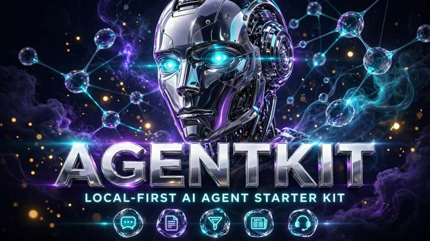

# 🤖 AgentKit — Local-First AI Agent Starter Kit

[](https://n8n.io)
[](LICENSE)
[](https://github.com/onyxailabs/AgentKit/pulls)
[]()
[]()

**Stop renting AI. Own your agents.**

AgentKit is five complete, import-ready [n8n](https://n8n.io) workflows — each one a working AI agent that runs on **your** infrastructure, with **your** data never leaving your hands. No cloud. No monthly fees. No coding needed.



---

🎬 **Watch the demo** — see all five agents in action: [YouTube](https://youtu.be/Q0hFOdTNvDU)

## The 5 Agents

| # | Agent | What it does |
|---|-------|--------------|
| 1 | 💬 **Telegram AI Assistant** | Chat with AI on Telegram with full conversation memory. Change one prompt to give it a new personality. |
| 2 | 🔁 **Content Repurposer** | Send `/repurpose <topic>` → get back an X thread, LinkedIn post, Instagram caption & YouTube pack in ~60 seconds. |
| 3 | 🎯 **Lead Qualifier** | Point your website form at the webhook → AI scores every lead 1–10 → instant Telegram alert on hot ones. |
| 4 | 📰 **Daily Researcher** | Every morning at 8 AM, an AI digest of your RSS feeds lands on Telegram. English or Roman Urdu. |
| 5 | 🛟 **Support Bot** | Answers **only** from your FAQ sheet. Never hallucinates. Unknown question → sends your contact instead. |

---

## Why local-first?

| | Typical AI tools | AgentKit |
|---|---|---|
| Cost | $20–50/month forever | $0 to run |
| Your data | Lives on their servers | Never leaves your stack |
| AI provider | Locked in | Ollama (free) **or** OpenAI — one setting switches |
| Memory & logs | Their database | Your Google Sheets (free) |
| Interface | Their app | Your Telegram bot (free) |
| Runtime | Their cloud | Your n8n (free, self-hosted) |

---

## ⚡ Quickstart (15 minutes)

**You need:** n8n v2.x (self-hosted or Cloud — free tier works), a Telegram bot token ([@BotFather](https://t.me/BotFather), free), a Google account (free), and either [Ollama](https://ollama.ai) running locally or an OpenAI API key.

1. **Download** this repo (or clone it).
2. In n8n: **Workflows → Import from file** → pick a workflow JSON.
3. Open the workflow's **⚙️ CONFIG node** — fill in your Telegram token, Sheet IDs, and AI provider. Every setting lives in this one node.
4. Read the **📌 sticky note** on the canvas — it's the setup guide for that agent.
5. Hit **Active**. Done. Your agent is live.

📕 New here? Read **[START-HERE.pdf](START-HERE.pdf)** first — it walks through all five agents step by step.

⚙️ Every field explained in **[CONFIG.md](CONFIG.md)**.

---

## 🗂 What's inside

```
AgentKit/
├── workflows/
│   ├── agentkit-01-telegram-assistant.json
│   ├── agentkit-02-content-repurposer.json
│   ├── agentkit-03-lead-qualifier.json
│   ├── agentkit-04-daily-researcher.json
│   └── agentkit-05-support-bot.json
├── assets/
│   └── agentkit-cover.png
├── START-HERE.pdf      ← read this first
├── CONFIG.md           ← every setting explained
└── LICENSE             ← community license
```

---

## 🆓 Community vs 💼 Commercial

This repo is the **free Community edition** — perfect for personal projects and learning.

| | Community (this repo) | Commercial |
|---|---|---|
| Personal use | ✅ | ✅ |
| Client projects | ❌ | ✅ unlimited |
| Keep modifications private | ❌ (share-alike) | ✅ |
| Price | Free forever | **$59 one-time** |

Need it for client work? Get the commercial license (one-time payment, lifetime v1.x updates):

👉 **[Get AgentKit Commercial — $59](https://mohsina91.gumroad.com/l/znqkv)** · 🎟️ code `AGENTLAUNCH` = $10 off

---

## 🤝 Contributing

Found a bug? An agent misbehaving on import? Open an issue — I fix reported import bugs same day. PRs welcome: keep workflows import-clean on n8n v2.x and document new CONFIG fields in CONFIG.md.

---

## 📄 License

Community edition: share-alike, non-commercial — see [LICENSE](LICENSE). For commercial use, grab the commercial license above.

---

Built with ⚡ by [Onyx AI](https://onyxailabs.github.io/Catalog/) · Questions? Open an issue.
